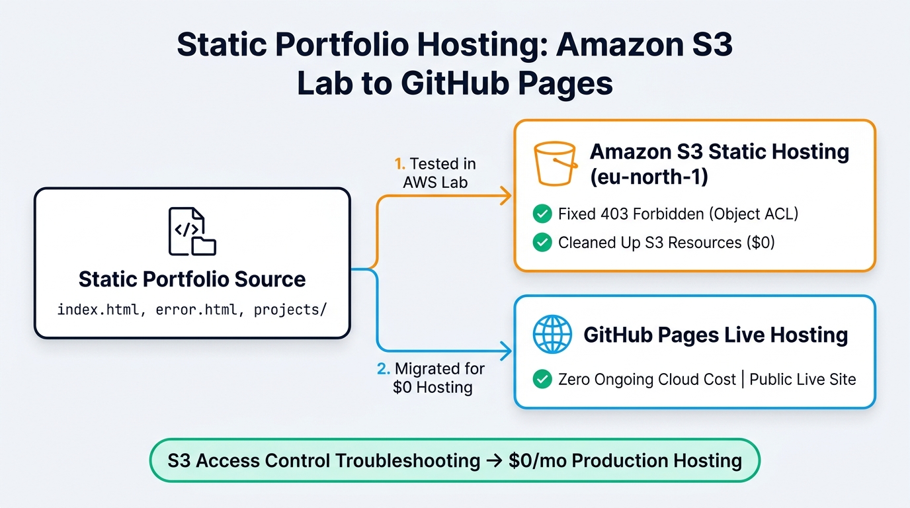
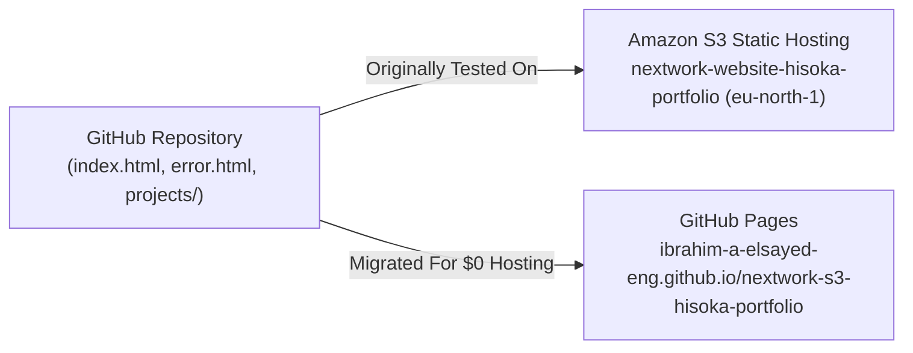

# Ibrahim Ahmed (Hisoka) — Cloud & DevOps Portfolio

**Static Cloud & DevOps portfolio originally hosted on Amazon S3 (`eu-north-1`) and migrated to GitHub Pages for `$0` ongoing hosting cost.**

🔗 **Live Site:** [ibrahim-a-elsayed-eng.github.io/nextwork-s3-hisoka-portfolio](https://ibrahim-a-elsayed-eng.github.io/nextwork-s3-hisoka-portfolio/)

---

## 1. Architecture Overview

> [!IMPORTANT]
> **Key Design Decision:** Built and validated S3 static website hosting first (troubleshooting `403 Forbidden` ACLs and restrictive bucket policies), then migrated live hosting to **GitHub Pages** to eliminate ongoing AWS S3 storage/request costs while expanding the portfolio.

---

## 2. Problem & Solution

| Aspect | Detail |
| :--- | :--- |
| **Problem** | Needed a live public portfolio beyond a basic single HTML page without paying recurring cloud hosting fees after completing the S3 lab. |
| **Solution** | Built a multi-page static portfolio (`index.html`, `error.html`, `projects/`, banners), deployed and tested it on Amazon S3, then migrated hosting to GitHub Pages. |
| **Troubleshooting & Security** | Resolved `403 Forbidden` by making objects public via ACL during the S3 lab, and resolved object-deletion access denied errors by removing the restrictive bucket policy. |

---

## 3. Tech Stack
- **Cloud Lab:** Amazon S3 Static Website Hosting (`nextwork-website-hisoka-portfolio`, `eu-north-1`)
- **Production Hosting:** GitHub Pages
- **Frontend:** HTML, CSS, JavaScript
- **Version Control:** Git & GitHub

---

## 4. Implementation Steps & Portfolio Index

| Project | Type | Status | Page |
| :--- | :--- | :--- | :--- |
| **Hosting a Static Website on Amazon S3** | NextWork Project | Completed | [projects/aws-s3-hosting.html](./projects/aws-s3-hosting.html) |
| **AWS IAM Cloud Security & ABAC Access Control** | NextWork Project | Completed | [projects/iam-cloud-security.html](./projects/iam-cloud-security.html) |
| **AWS VPC Series (Part 1: Console & CLI)** | NextWork Project | In progress (1 of 9) | [projects/aws-vpc-networking.html](./projects/aws-vpc-networking.html) |
| **Linux Log Watchdog & Hardening Practice** | Training Project (Ubuntu WSL) | Completed | [projects/linux-log-watchdog.html](./projects/linux-log-watchdog.html) |

> *Note: `projects/disk-space-monitor.html` also exists in the repository and is pending content review.*

<b>Click to expand Repository Structure</b>

- `index.html` & `error.html` — Main portfolio landing page, project cards, and custom error page
- `projects/` — Individual project and series detail pages (`vpc-part-1.html`, `aws-s3-hosting.html`, etc.)
- `images/` — Project screenshots (`vpc-part1-1.png`, `vpc-part1-2.png`, `vpc-part1-3.png`)
- `hisoka-banner.jpg`, `iam-abac-banner.jpg`, `vpc-banner.jpg`, `linux-banner.jpg` — Project banners

---

## 5. Verification & Results
- **Live Portfolio URL:** [ibrahim-a-elsayed-eng.github.io/nextwork-s3-hisoka-portfolio](https://ibrahim-a-elsayed-eng.github.io/nextwork-s3-hisoka-portfolio/)
- Verified S3 static hosting (`403` ACL & bucket policy cleanup) before migrating cleanly to GitHub Pages.

---

## 6. Key Engineering Takeaways
- **S3 Access Control Layers:** Public static hosting on S3 requires aligning Block Public Access, bucket policies, and object ACLs—and checking bucket policies when delete operations fail.
- **Cost-Aware Hosting:** Using AWS S3 for hands-on learning and GitHub Pages for long-term static portfolio hosting keeps recurring costs at `$0`.
