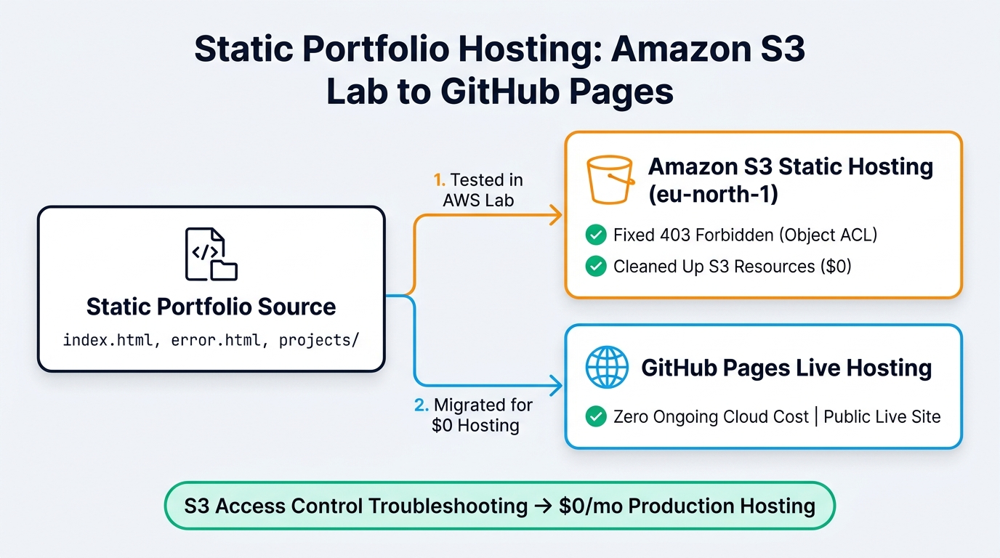
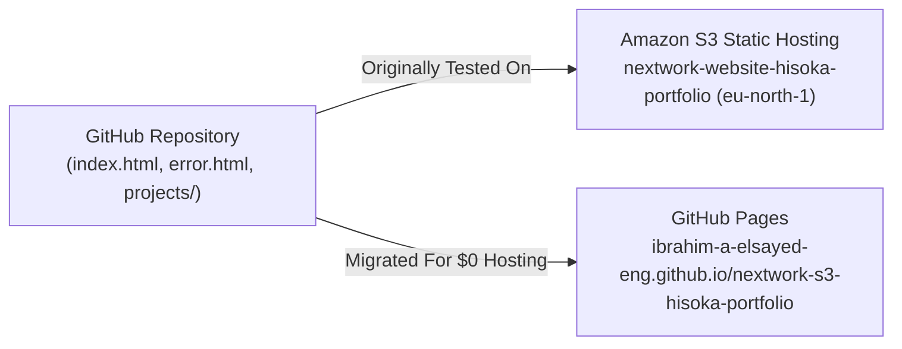

# Ibrahim Ahmed El Sayed — Amazon S3 Static Hosting Lab (Migrated)

> **Notice:** Production portfolio hosting has been upgraded and moved to **[ibrahim-a-elsayed-eng.github.io](https://ibrahim-a-elsayed-eng.github.io/)** (`https://github.com/ibrahim-a-elsayed-eng/ibrahim-a-elsayed-eng.github.io`). This repository now serves as the preserved Amazon S3 lab proof and automatic redirect so legacy links never break.

**Static portfolio originally tested on Amazon S3 (`eu-north-1`) and migrated to [ibrahim-a-elsayed-eng.github.io](https://ibrahim-a-elsayed-eng.github.io/) for `$0` ongoing hosting cost.**

🔗 **Active Portfolio:** [ibrahim-a-elsayed-eng.github.io](https://ibrahim-a-elsayed-eng.github.io/)

---

## 1. Architecture Overview

> [!IMPORTANT]
> **Key Design Decision:** Built and validated S3 static website hosting first (troubleshooting `403 Forbidden` ACLs and restrictive bucket policies), then migrated live hosting to **GitHub Pages** to eliminate ongoing AWS S3 storage/request costs while expanding the portfolio.

---

## 2. Problem & Solution

| Aspect | Detail |
| :--- | :--- |
| **Problem** | Needed a live public portfolio beyond a basic single HTML page without paying recurring cloud hosting fees after completing the S3 lab. |
| **Solution** | Built a multi-page static portfolio (`index.html`, `error.html`, `projects/`, banners), deployed and tested it on Amazon S3, then migrated hosting to GitHub Pages. |
| **Troubleshooting & Security** | Resolved `403 Forbidden` by making objects public via ACL during the S3 lab, and resolved object-deletion access denied errors by removing the restrictive bucket policy. |

---

## 3. Tech Stack
- **Cloud Lab:** Amazon S3 Static Website Hosting (`nextwork-website-hisoka-portfolio`, `eu-north-1`)
- **Production Hosting:** GitHub Pages
- **Frontend:** HTML, CSS, JavaScript
- **Version Control:** Git & GitHub

---

## 4. Implementation Steps & Portfolio Index

| Project | Type | Status | Page |
| :--- | :--- | :--- | :--- |
| **Hosting a Static Website on Amazon S3** | NextWork Project | Completed | [projects/aws-s3-hosting.html](./projects/aws-s3-hosting.html) |
| **AWS IAM Cloud Security & ABAC Access Control** | NextWork Project | Completed | [projects/iam-cloud-security.html](./projects/iam-cloud-security.html) |
| **AWS VPC Networking Series (Parts 1–2)** | NextWork Project | In progress (2 of 9) | [projects/aws-vpc-networking.html](./projects/aws-vpc-networking.html) |
| **Linux Log Watchdog & Hardening Practice** | Training Project (Ubuntu WSL) | Completed | [projects/linux-log-watchdog.html](./projects/linux-log-watchdog.html) |

<b>Click to expand Repository Structure</b>

- `index.html` & `error.html` — Main portfolio landing page, project cards, and custom error page
- `projects/` — Individual project and series detail pages (`vpc-part-1.html`, `aws-s3-hosting.html`, etc.)
- `images/` — Project screenshots (`vpc-part1-1.png`, `vpc-part1-2.png`, `vpc-part1-3.png`)
- `hisoka-banner.jpg`, `iam-abac-banner.jpg`, `vpc-banner.jpg`, `linux-banner.jpg` — Project banners

---

## 5. Verification & Results
- **Live Portfolio URL:** [ibrahim-a-elsayed-eng.github.io/nextwork-s3-hisoka-portfolio](https://ibrahim-a-elsayed-eng.github.io/nextwork-s3-hisoka-portfolio/)
- Verified S3 static hosting (`403` ACL & bucket policy cleanup) before migrating cleanly to GitHub Pages.

---

## 6. Troubleshooting & Fixes
- **Issue 1 (`403 Forbidden` on S3 Static Endpoint):** Uploading files with private default permissions blocked public browser access to the S3 website endpoint.
  - **Root Cause & Fix:** Enabled public object read access via ACLs during the S3 lab so `index.html` and assets served cleanly.
- **Issue 2 (`AccessDenied` on S3 Object Deletion):** Deleting lab objects failed during teardown due to a restrictive S3 bucket policy.
  - **Root Cause & Fix:** Removed the restrictive bucket policy first, then emptied and deleted the S3 bucket cleanly.

---

## 7. Cost & Teardown Verification ($0.00)
- [x] Amazon S3 lab bucket (`nextwork-website-hisoka-portfolio`, `eu-north-1`) emptied and deleted after verification.
- [x] Live portfolio migrated to GitHub Pages (`$0.00` ongoing AWS spend).

---

## 8. Key Engineering Takeaways
- **S3 Access Control Layers:** Public static hosting on S3 requires aligning Block Public Access, bucket policies, and object ACLs—and checking bucket policies when delete operations fail.
- **Cost-Aware Hosting:** Using AWS S3 for hands-on learning and GitHub Pages for long-term static portfolio hosting keeps recurring costs at `$0`.
